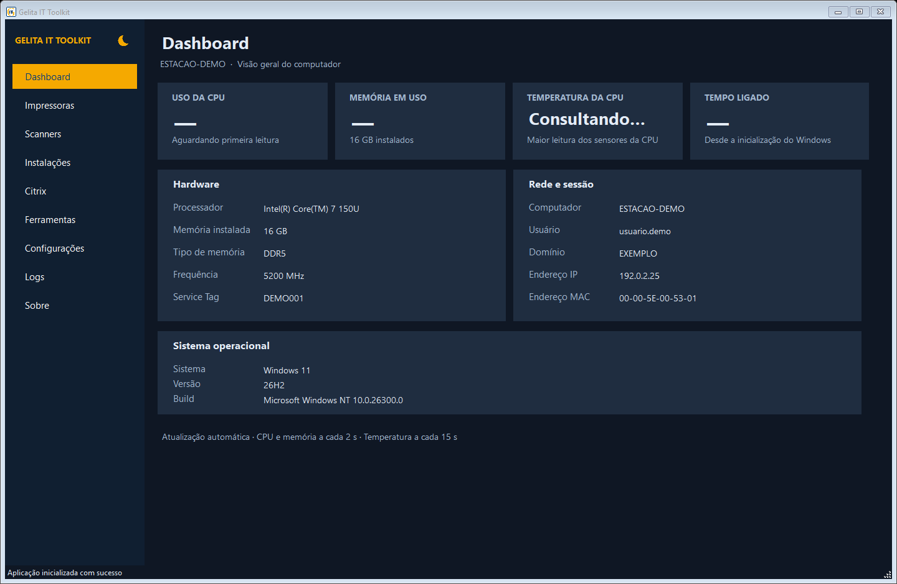
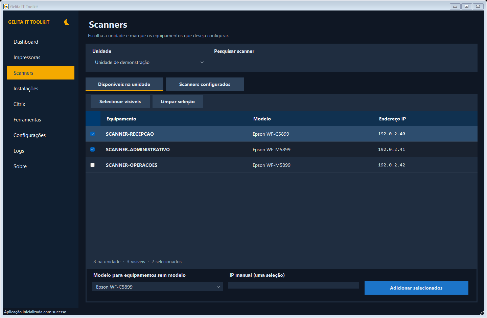
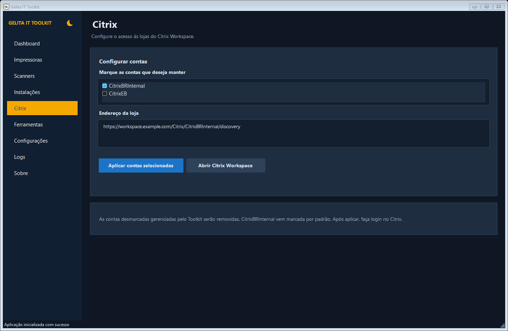
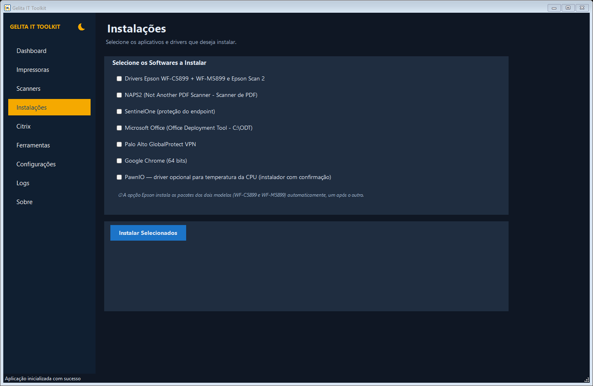

  

<h1 align="center">Gelita IT Toolkit</h1>

  Ferramentas para suporte, configuração e manutenção de estações Windows.

  <a href="https://github.com/pedrolucasgelitati-byte/Gelita-IT-Toolkit/releases/latest"><strong>Baixar versão mais recente</strong></a>
  &nbsp;·&nbsp;
  <a href="#interface-do-programa">Conhecer a interface</a>
  &nbsp;·&nbsp;
  <a href="docs/GUIA-TECNICO.md">Documentação técnica</a>

---

O **Gelita IT Toolkit** reúne rotinas do Service Desk em uma aplicação portátil: preparação de computadores, gerenciamento de impressoras e scanners, configuração do Citrix Workspace e diagnóstico do Windows.

O objetivo é padronizar tarefas recorrentes, reduzir etapas manuais e manter as operações organizadas em uma única interface.

| Plataforma | Tecnologia | Distribuição |
| --- | --- | --- |
| Windows x64 | C# · .NET 8 · Windows Forms | Pacote portátil com runtime incluído |

## Interface do programa

### Dashboard

Visão centralizada de hardware, sistema operacional, rede e sessão do Windows.

Capturas da interface da versão 1.0.7 em ambiente de demonstração. Os dados de identificação, rede e equipamentos foram substituídos por exemplos para preservar informações corporativas.

<strong>Scanners — seleção de equipamentos e configuração por unidade</strong>

Pesquisa, seleção múltipla e organização dos scanners disponíveis e configurados.

<strong>Citrix — gerenciamento das contas corporativas</strong>

Seleção das contas CitrixBRInternal e CitrixEB na área administrativa, com aplicação das contas selecionadas.

<strong>Instalações — aplicativos e drivers em um único lugar</strong>

Seleção dos aplicativos e pacotes necessários para preparar a estação de trabalho.

## Funcionalidades

| Área | Recursos |
| --- | --- |
| **Dashboard** | Informações do computador, hardware, versão instalada do Windows e build completo. |
| **Impressoras** | Organização por unidade, instalação individual ou em lote, impressora padrão, página de teste e diagnóstico de conectividade. |
| **Scanners** | Configuração de equipamentos Epson, seleção múltipla, perfis de digitalização e integração com NAPS2. |
| **Instalações** | Drivers Epson, Epson Scan 2, NAPS2 e aplicativos corporativos, conforme os pacotes disponíveis no ambiente. |
| **Citrix Workspace** | Configuração das contas CitrixBRInternal e CitrixEB. Na área administrativa, seleção de uma ou ambas e remoção das contas gerenciadas desmarcadas. |
| **Windows** | Instalação das atualizações 25H2 e 26H2. A ISO corporativa já contém o Windows 11 24H2. |
| **Diagnóstico e manutenção** | Ferramentas de rede, verificações do sistema, reparos e manutenção do spooler de impressão. |
| **Configurações e logs** | Configuração externa, validação de integridade dos pacotes e registro das operações. |

## Download e instalação

1. Acesse a [versão mais recente](https://github.com/pedrolucasgelitati-byte/Gelita-IT-Toolkit/releases/latest) e baixe o arquivo ZIP.
2. Confira a integridade com o arquivo `.sha256` disponibilizado na mesma publicação.
3. Extraia **todo o conteúdo** em uma pasta local gravável.
4. Mantenha `Assets` e `Config` junto ao executável e forneça as configurações e os instaladores corporativos necessários.
5. Execute `Gelita-IT-Toolkit.exe` e utilize uma conta administrativa autorizada nas operações que exigirem elevação.

O pacote publicado inclui o runtime .NET. Não é necessário instalar o SDK para executar o programa nas estações.

## Configuração do ambiente

O pacote público utiliza exemplos de configuração. Inventário, endereços internos, credenciais e instaladores corporativos devem ser fornecidos por canal autorizado.

- **Config:** arquivos JSON com unidades, equipamentos e configurações do ambiente.
- **Assets:** pacotes auxiliares e instaladores de terceiros.
- **.env:** variáveis locais, quando utilizadas; não deve ser publicado no repositório.

Consulte as [notas da versão](https://github.com/pedrolucasgelitati-byte/Gelita-IT-Toolkit/releases/latest) para detalhes do pacote, validações realizadas e observações de distribuição.

## Documentação

| Documento | Conteúdo |
| --- | --- |
| [Guia técnico](docs/GUIA-TECNICO.md) | Requisitos, estrutura do projeto, configuração, compilação, publicação, segurança e solução de problemas da branch main. |
| [Histórico de versões](https://github.com/pedrolucasgelitati-byte/Gelita-IT-Toolkit/releases) | Pacotes para download e alterações de cada versão. |
| [Issues](https://github.com/pedrolucasgelitati-byte/Gelita-IT-Toolkit/issues) | Registro de problemas e propostas de melhoria, sem incluir informações internas ou credenciais. |

---

**Uso interno · Gelita AG — Service Desk**
Instalação, manutenção e distribuição devem seguir as políticas corporativas e ser realizadas por pessoal autorizado.
